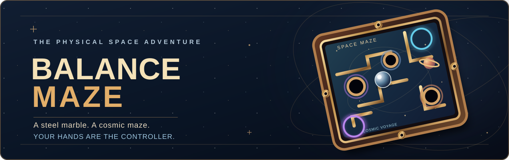

  

<h1 align="center">Balance Maze ✦ Cosmic Voyage</h1>

  <strong>A little wooden maze. A whole universe to explore.</strong> 
  Tilt a beautifully crafted 3D labyrinth with your own hands, guide a steel marble through danger, and explore a retro-futuristic space adventure — right in your browser.

  
  
  

  <a href="https://resarytrew.github.io/balance-maze-gesture-control/"><strong>Play in your browser ↗</strong></a>
  &nbsp;·&nbsp;
  <a href="#quick-start"><strong>Run locally</strong></a>
  &nbsp;·&nbsp;
  <a href="#controls"><strong>Controls</strong></a>
  &nbsp;·&nbsp;
  <a href="#contributing"><strong>Contribute</strong></a>

> [!NOTE]
> **No special controller required.** A webcam lets you steer by moving your hands. No webcam? Play with a mouse or keyboard instead.
>
> *The banner above is original illustrative artwork, not a screenshot of gameplay.*

## Why Balance Maze?

Balance Maze blends the hands-on charm of a vintage wooden tilt maze with real-time 3D graphics and a playful space adventure.

| | What you get |
| :-- | :-- |
| **🤲 Hands as the controller** | Use webcam hand tracking to tilt the board naturally. Your gestures control the same physical board you see on screen. |
| **⚙️ Satisfying marble physics** | Feel momentum, grip, rolling resistance, wall collisions, rounded obstacles, and the danger of open holes. |
| **🪐 A miniature space adventure** | Explore three connected missions, rescue signal beacons, travel through portals, and earn stars. |
| **🤏 A little magic** | Pinch your thumb and index finger together to temporarily slow down time in Cosmic Voyage. |
| **🎮 Play your way** | Classic labyrinths, generated mazes, webcam, mouse, and WASD/arrow keys. |
| **🔒 Privacy-conscious** | Hand detection and game physics run locally in your browser; no game account or video-upload backend is needed. |

## Choose your adventure

### 🪵 Classic Maze

The original skill challenge. Steer a steel marble across a polished wooden playing field, avoid the holes, and reach the finish.

- **Five handcrafted levels** with increasing difficulty.
- **Procedurally generated mazes** for fresh runs.
- A precision-first experience with no special powers.
- Time records saved locally in your browser.

### 🚀 Cosmic Voyage

A three-part, 1960s-inspired space expedition. The familiar wooden machinery remains, but the playing field becomes a miniature universe of stars, planets, dark holes, and glowing wormholes.

| Chapter | Destination | Your mission |
| :-- | :-- | :-- |
| **01** | **Signal from Saturn** | Activate two rescue beacons and discover your first pair of portals. |
| **02** | **Lunar Ruins** | Navigate abandoned corridors, avoid hazardous craters, and restore the lunar beacons. |
| **03** | **Heart of the Nebula** | Survive the final maze, with extra hazards and three signals to recover. |

Collect the required beacons before reaching the station. Complete a chapter to unlock the next, earn a star, and watch your tiny rescue rocket lift off.

### ✨ Slow down time with a pinch

Special powers belong to **Cosmic Voyage only** — the underlying rolling and collision physics stay the same.

1. **Collect a beacon** to earn a time-dilation charge.
2. **Bring your thumb and index finger together on either hand** and hold for approximately **0.2 seconds**.
3. Enjoy **2.8 seconds of slow-motion gameplay** to navigate a tricky turn.
4. **Separate your fingers** before activating another charge.

The gesture works with the MediaPipe hand model when **both hands are visible** to the camera. If your camera or hand model is unavailable, use **Space** or the on-screen ability button instead. You can store up to three charges.

## Controls

| Input | Action |
| :-- | :-- |
| **Two hands + webcam** | Tilt the board. Move your hands according to the selected control profile; calibrate for your natural resting position. |
| **Thumb + index finger pinch** | Activate slow motion in Cosmic Voyage (either hand, MediaPipe tracking, charged ability required). |
| **Mouse** | Drag the playing field to tilt it. |
| **WASD / arrow keys** | Tilt the board without a camera. |
| **Space** | Activate slow motion in Cosmic Voyage (keyboard fallback). |
| **R** | Restart the current level. |
| **C** | Calibrate hand tracking. |
| **P** | Toggle the cinematic presentation mode. |

**Webcam tip:** Face the camera with both hands visible, use even lighting, and choose **Auto Calibrate** before starting. If a tracked hand disappears, gameplay pauses rather than allowing the marble to roll away on stale camera input.

## Quick start

**Play instantly:** **[Launch Balance Maze →](https://resarytrew.github.io/balance-maze-gesture-control/)**

For local development, you'll need **Node.js 22+**, **npm**, and a modern desktop browser.

~~~bash
git clone https://github.com/resarytrew/balance-maze-gesture-control.git
cd balance-maze-gesture-control
npm ci
npm run dev
~~~

Open **http://localhost:3000** (or the URL printed by Vite).

The webcam requires a secure browser context: **localhost** works for local development, and the hosted demo uses **HTTPS**. Grant camera permission when prompted. Mouse and keyboard controls work without camera permission.

### Build and test

~~~bash
npm run lint      # TypeScript type-check
npm test          # automated physics, gesture, and mission tests
npm run build     # production bundle → dist/
npm run preview   # preview the production build
~~~

GitHub Actions runs installation, type-checking, tests, and the production build before deployment to GitHub Pages.

## How it works

~~~text
Webcam
  └── MediaPipe Hand Landmarker (21 landmarks per hand)
       ├── Hand position → target pitch / roll
       └── Finger-tip pinch → time-dilation ability (Cosmic Voyage only)

Mouse / WASD ────────────────┐
Hand target pitch / roll ────┤
                             ▼
                     Damped board motion
                             ▼
                     Fixed-step marble physics (120 Hz)
                             ▼
                     Three.js board + ball rendering
                             └── mission effects, portals, HUD and audio
~~~

**Tech stack:** React 19 · TypeScript · Three.js · Vite · MediaPipe Tasks Vision · Tailwind CSS · Canvas-based procedural artwork.

The project uses a fixed-step custom physics simulation for the steel marble, including static and kinetic contact, small rolling resistance, wall impacts, and geometric hole interactions. Mission-specific effects such as portals and time dilation are layered on top; they do not change the tuned friction coefficients.

### Project layout

~~~text
.github/
  workflows/           Continuous integration and GitHub Pages deployment
  ISSUE_TEMPLATE/      Bug reports and feature requests
docs/
  assets/              README illustration
src/
  App.tsx              Game lifecycle and input-to-physics integration
  components/
    ThreeLabyrinth.tsx Three.js scene, board, marble and effects
    HUD.tsx            Game interface and chapter progression
    WebcamOverlay.tsx  Camera setup and hand-tracking interface
  game/
    physics.ts         Marble and board simulation
    handTracker.ts     MediaPipe tracking and input modes
    pinchGesture.ts    Debounced finger-pinch recognition
    mission.ts         Cosmic chapters, portals and powers
    levels.ts          Classic and generated labyrinths
    validator.ts       Level reachability checks
    spaceField.ts      Procedural retro-space artwork
    audio.ts           Game sound
~~~

## Privacy, compatibility & limitations

- **Camera frames are processed in the browser.** The application doesn't implement a backend that receives or stores your webcam video.
- **MediaPipe's WASM runtime and hand-landmarker model are currently downloaded from third-party CDNs.** An internet connection is needed to retrieve them, and those providers can receive ordinary network requests. The model then runs locally in the browser.
- **Pinch detection requires MediaPipe landmarks.** The simpler optical fallback can estimate hand positions but cannot reliably identify individual fingertips.
- **Camera control is designed for desktop browsers.** Detection quality depends on lighting, camera placement, and whether both hands remain visible.
- **Not an offline-first app yet.** The online demo also needs an internet connection to load the site.

If webcam control doesn't work, switch to **Mouse** or **WASD** — the rest of the game is still playable.

## Contributing

Bug reports, accessibility feedback, level ideas, and contributions are welcome.

1. Check existing [issues](https://github.com/resarytrew/balance-maze-gesture-control/issues) before opening a new one.
2. Read [CONTRIBUTING.md](./CONTRIBUTING.md) for setup, testing, and pull request guidance.
3. Please protect the **current marble feel**: physics changes should include focused tests and an explanation of their effect on gameplay.

Want to improve something? **[Open an issue →](https://github.com/resarytrew/balance-maze-gesture-control/issues/new/choose)**

## What's next?

- [ ] More interactive cosmic events and distinctive new chapter environments.
- [ ] An even clearer first-time hand-tracking tutorial.
- [ ] Local hosting of MediaPipe model assets for more reliable loading.
- [ ] Accessibility and control-sensitivity presets.
- [ ] Shareable challenges and replay features.

These are ideas for future development, not features already available in the live demo.

## License

Balance Maze is released under the **[MIT License](./LICENSE)**.

---

  <strong>Made for the joy of discovery — one careful tilt at a time.</strong> 
  <a href="https://resarytrew.github.io/balance-maze-gesture-control/">Play the game</a>
  ·
  <a href="https://github.com/resarytrew/balance-maze-gesture-control/issues">Share feedback</a>
  ·
  <a href="https://github.com/resarytrew/balance-maze-gesture-control">Explore the source</a>

